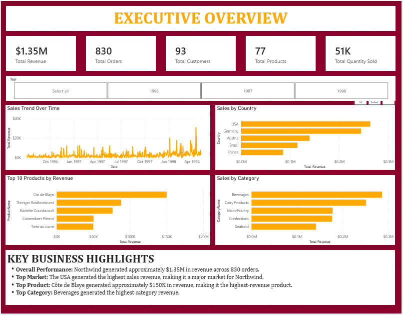
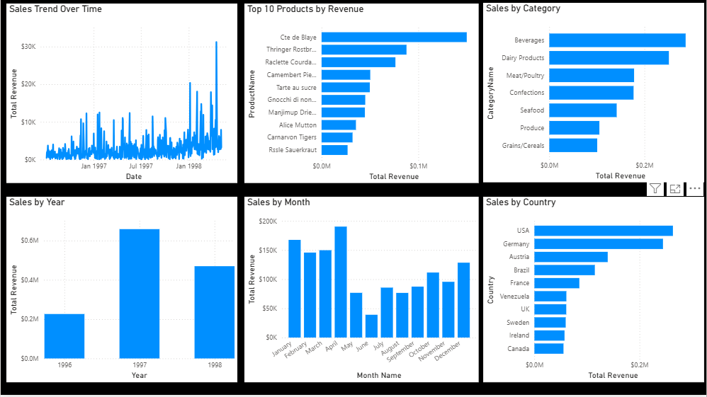
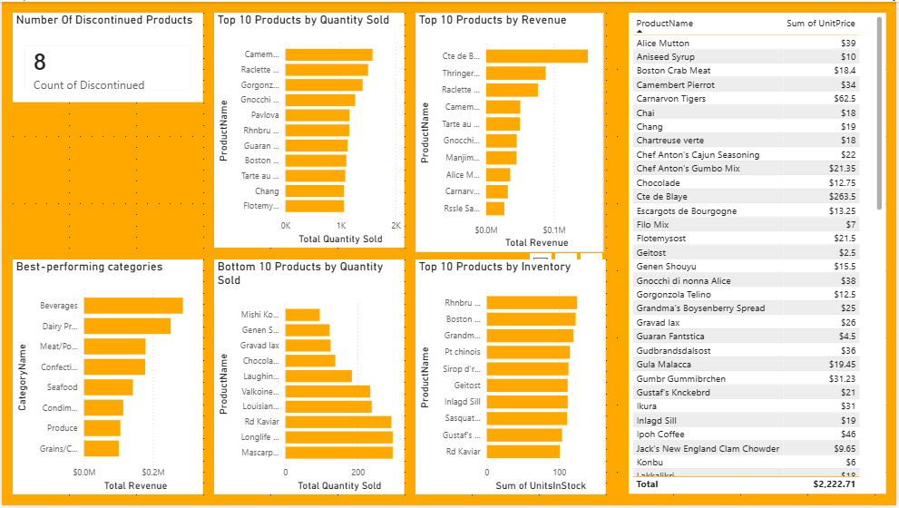
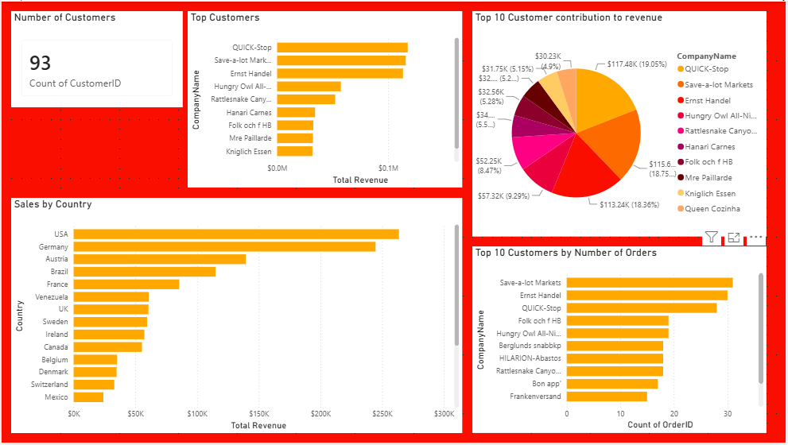
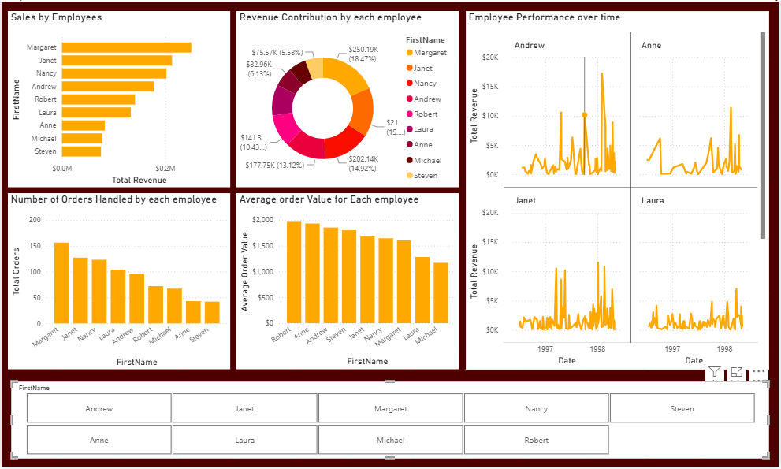
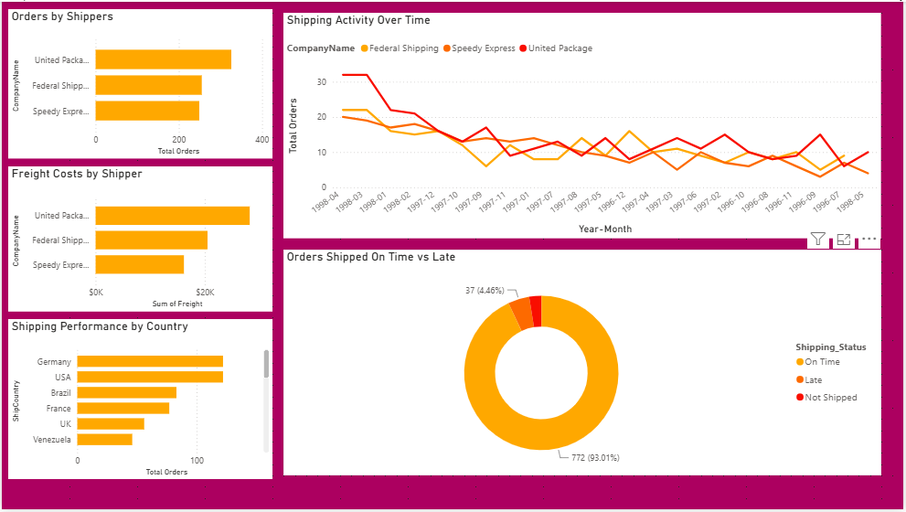

# Northwind Sales & Business Performance Analysis

**Author:** Yekini Abdulroqeeb Ademola  
**Project:** Techie Academy Capstone Project  
**Tools:** Microsoft Power BI Desktop, SQLite ODBC, Power Query, DAX, GitHub

## Project overview

This capstone analyzes Northwind Traders' historical sales and business operations data. The objective is to turn transactional data into business information that can support management decisions about sales performance, products, customers, employees, and shipping operations.

The Power BI report contains six pages: Executive Overview, Sales Analysis, Product Performance, Customer Analysis, Employee/Sales Performance, and Shipping & Operations.

## Business questions

- What is the overall revenue and order performance?
- How do sales vary across the available time period?
- Which products and categories contribute the most revenue, and which products lead by quantity?
- Which customer accounts and countries contribute the most sales?
- How do employee-associated sales differ when measured by revenue, order count, and average order value?
- What does the available shipping data show about shipment timing and freight costs?

## Project snapshot

| Metric | Observed result |
|---|---:|
| Total revenue | Approximately **$1.35M** |
| Total orders | **830** |
| Average order value | Approximately **$1.63K** |
| Customers | **93** |
| Products | **77** |
| Categories | **8** |
| Recorded order period | **4 July 1996 – 6 May 1998** |

Figures are approximate and should be confirmed against the final refreshed Power BI file before formal assessment or reuse.

## Dashboard preview

### Executive Overview

### Sales Analysis

### Product Performance

### Customer Analysis

### Employee & Sales Performance

### Shipping & Operations

## Key findings

1. **Sales reporting periods require care.** Revenue was approximately $1.35M across 830 orders. 1997 was the highest annual total in the report (approximately $660K), but 1996 and 1998 are partial years, so raw annual totals are not like-for-like growth comparisons.
2. **Revenue and volume identify different product leaders.** Côte de Blaye generated approximately $150K in revenue, while Camembert Pierrot led by quantity sold. Beverages was the highest-revenue category, followed by Dairy Products.
3. **Customer revenue and order frequency differ.** The USA was the highest-revenue market, followed by Germany and Austria. QUICK-Stop generated approximately $117.48K, slightly ahead of Save-a-lot Markets at approximately $115.67K; Save-a-lot Markets placed more orders.
4. **Employee-associated sales vary by metric.** Margaret was associated with approximately $250.19K in revenue and around 156 orders. Robert had the highest average order value at approximately $1,950. These figures alone do not establish individual productivity.
5. **Shipping performance is mostly on time by the recorded-date measure, with exceptions.** 772 orders were shipped on or before the required date, 37 were late, and 21 had no recorded shipped date. This compares `ShippedDate` with `RequiredDate`; it does not measure actual delivery arrival.

## Recommendations

- Standardize monthly reporting for revenue, order count, and average order value; compare equivalent periods.
- Monitor high-value customers using revenue, repeat-order frequency, and average order value.
- Review inventory against recent sales velocity for high-revenue and high-volume products, and check replacement options for discontinued items.
- Investigate the 37 late shipment records and the 21 orders without a recorded shipped date.
- Compare shipping providers using average freight cost per order and shipment timeliness, rather than total freight alone.
- Evaluate employee-associated sales with multiple measures and appropriate context for assignments, workload, and time period.

## Tools and workflow

- **Power BI Desktop:** interactive, multi-page report and KPI presentation.
- **SQLite3 ODBC Driver:** documented connection method for the SQLite source database.
- **Power Query:** data preparation where required.
- **DAX:** report measures and KPI calculations.
- **GitHub:** project versioning and public documentation.

The detailed connection notes and business insights document are available in `documentation/` and `pdf/`.

## How to use the project

1. Download `powerbi/Northwind_Analysis.pbix`.
2. Open it in Microsoft Power BI Desktop.
3. If Power BI prompts for a data source or refresh, configure the required source connection on your machine. The source `Northwind.db` file was not included among the files provided for this repository package.
4. Use the page tabs to explore the six report sections.
5. Review the CEO presentation and supporting documentation for the analysis, interpretation notes, and recommendations.

## Data and interpretation notes

- The historical order data covers 4 July 1996 through 6 May 1998.
- Figures are rounded or approximate where indicated.
- Revenue is not the same as profit; the provided visuals do not establish product profit margins.
- Shipment timing is based on recorded shipped and required dates, not actual delivery-arrival timestamps.
- The available data does not prove the causes of sales peaks, product discontinuation, customer retention risk, or shipping delays.

## Author

**Yekini Abdulroqeeb Ademola**  
Data Analyst | Techie Academy Capstone Project
